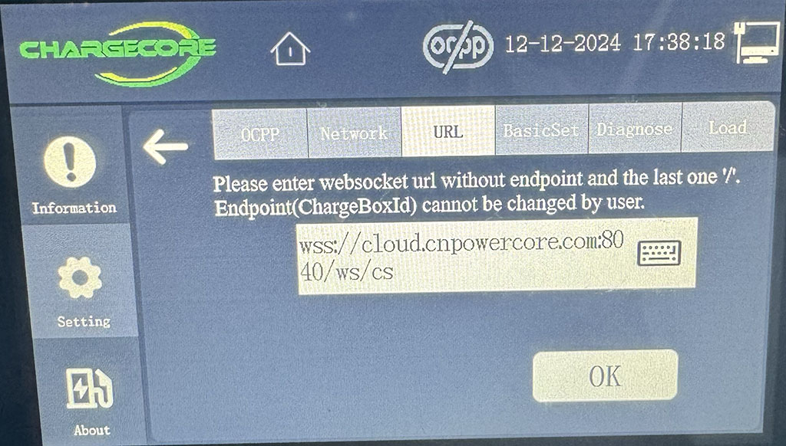

# homebridge-chargecore

`homebridge-chargecore` is an OCPP 1.6 JSON central system for exposing Chargecore EV wall chargers as HomeKit accessories.

## Supported Devices
The following Chargecore devices have been tested with this plugin
- AC003PT27

## Charger configuration

<table>
  <tr>
    <td width="55%" valign="top">
      
    </td>
    <td width="45%" valign="top">
      <ol>
        <li>Log in through the cog icon (default password: <code>123456</code>).</li>
        <li>Go to <strong>Settings → URL</strong>.</li>
        <li>Replace the URL with <code>ws://HOME_BRIDGE_HOST:9443/chargecore</code>.</li>
        <li>Press <strong>OK</strong> and wait for the success message to disappear. Do not press OK again.</li>
      </ol>
    </td>
  </tr>
</table>

## HomeKit representation

HomeKit does not define an EV charger service, so this plugin uses the closest native model:

- An **Outlet** starts and stops charging from Apple Home and Siri. It is on while a charging session is active (including when the vehicle or charger has suspended power delivery).
- `OutletInUse` is true while the charger reports `charging` or draws more than 50 W.
- Standard `StatusActive` and `StatusFault` characteristics reflect availability and faults.
- An optional **Contact Sensor** indicates that a vehicle is plugged in.

HomeKit has no standard energy characteristics, so live power and energy are published through Matter instead.

## Matter representation

When Matter is enabled for the bridge running this plugin (Homebridge 2.x with a `matter` section in the bridge config), each charger is also exposed as a Matter **On/Off Plug-in Unit** (outlet) alongside the HAP accessory:

- **On/Off** mirrors the HAP outlet and sends the same OCPP `RemoteStartTransaction` / `RemoteStopTransaction` calls.
- **Electrical Power Measurement** (AC) reports active power, voltage, and current from OCPP `MeterValues`, converted to Matter units (W → mW, V → mV, A → mA).
- **Electrical Energy Measurement** reports cumulative imported energy (kWh → mWh). Totals are pushed when they change, at most every 30 seconds.
- The bridged device is marked unreachable and live readings are cleared once the charger exceeds `offlineAfterSeconds`.

Controllers that support Matter 1.3 energy metrics, such as Apple Home on iOS 27, show the charger's live power draw. If both the HAP bridge and the Matter bridge are paired to the same home, the charger appears twice; hide or remove the one you don't need.

Accessories cached from earlier versions have their Eve-style energy and charger-state characteristics removed on startup.

## Requirements

- Homebridge 2.x
- Node.js 22 or 24
- An OCPP 1.6 JSON charger acting as a WebSocket client

## Install and build

```bash
npm install
npm run build
npm link
```

## Configuration

Add the platform through Homebridge UI, or add this to `config.json`:

```json
{
  "platform": "ChargeCore",
  "name": "ChargeCore",
  "host": "0.0.0.0",
  "port": 9443,
  "offlineAfterSeconds": 90,
  "allowedChargerIds": ["garage-wallbox"],
  "logWebSocketTraffic": false,
  "exposeVehicleSensor": true,
  "autoStartOnConnect": false
}
```

Set `autoStartOnConnect` to `true` to send `RemoteStartTransaction` as soon as the charger reports a vehicle plugged in (connector status changes to `Preparing`). A session stopped from Home stays stopped until the vehicle is unplugged and reconnected.

Without a `tls` section, the plugin listens using plain `ws://`. The endpoint does not require authentication, so expose its port only on a trusted, isolated network. Use `allowedChargerIds` to reject unexpected identifiers, but do not treat an identifier as a credential.

To enable `wss://`, add certificate paths that are readable inside the Homebridge container or process:

```json
"tls": {
  "certPath": "/var/lib/homebridge/chargecore/fullchain.pem",
  "keyPath": "/var/lib/homebridge/chargecore/privkey.pem"
}
```

Restart Homebridge after changing TLS files.

For mutual TLS, set `tls.clientCaPath` to a PEM CA file. The plugin will then require a client certificate signed by that CA.

## Docker Compose

The included [`docker-compose.test.yml`](./docker-compose.test.yml) is a minimal override for an existing Homebridge Compose deployment. It only mounts this repository at Homebridge's local plugin path.

```bash
cd /path/to/homebridge-chargecore
npm ci
npm run build
export CHARGECORE_PLUGIN_PATH="$PWD"

# Merge the plugin override with your existing Homebridge Compose definition.
docker compose \
  -f /path/to/existing-homebridge/docker-compose.yml \
  -f /path/to/homebridge-chargecore/docker-compose.test.yml \
  up -d
```

If your existing service is not named `homebridge`, change the service name in the override to match it. The host build supplies `dist/` and `node_modules/`, including the `ws` runtime dependency. If TLS is enabled, certificate paths must already be available inside the container.

## Charger connection

Connect to:

```text
ws://HOME_BRIDGE_HOST:9443/chargecore/CHARGEBOX_ID
```

The WebSocket base path is fixed to `/chargecore` and is not configurable. Configure `ws://HOME_BRIDGE_HOST:9443/chargecore` without a trailing slash; the charger must append its ChargeBox ID. Connections to the base path without an ID are rejected.

Compression is disabled and the default maximum message size is 65,536 bytes. Messages must be UTF-8 JSON text, not binary frames.

## OCPP 1.6 support

The server accepts OCPP 1.6 JSON array frames only. It handles `BootNotification`, `Heartbeat`, `StatusNotification`, `MeterValues`, `Authorize`, `StartTransaction`, `StopTransaction`, `DataTransfer`, `DiagnosticsStatusNotification`, and `FirmwareStatusNotification`.

`StatusNotification` drives availability, vehicle connection, charging state, and faults. `MeterValues` maps `Power.Active.Import`, `Energy.Active.Import.Register`, `Current.Import`, and `Voltage` into the Matter power and energy clusters. HomeKit and Matter on/off requests are sent as OCPP `RemoteStartTransaction` (using the last active connector and the `homebridge` idTag) and `RemoteStopTransaction` calls. Stopping requires a known transaction id, which is captured from `StartTransaction` or recovered from `MeterValues` after a reconnect.

Unsupported charger calls receive an OCPP `NotSupported` CALLERROR.

## Operational notes

- Set `offlineAfterSeconds` to at least three times the telemetry interval.
- Enable `logWebSocketTraffic` for full OCPP connection, message, command, acknowledgement, disconnect, and heartbeat diagnostics. Message payloads may contain sensitive charger data.
- Put charger IDs in `allowedChargerIds` whenever the set of devices is known.
- Keep the WebSocket port on a trusted LAN or firewall it to charger addresses. The endpoint does not require authentication; TLS is optional.
- A newer connection for the same charger ID replaces the older one.
- Accessories are discovered on the first accepted OCPP `BootNotification` and retained by Homebridge across restarts.

## Development

```bash
npm test
npm run lint
npm run build
```
